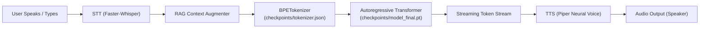

# 🎙️ demo-nano-voice: Edge AI Voice Assistant & Transformer from Scratch

[](https://opensource.org/licenses/MIT)
[](https://www.python.org/downloads/)
[](https://pytorch.org/)
[](https://www.nvidia.com/en-us/autonomous-machines/embedded-systems/jetson-orin/)

**Nano-Voice** is an end-to-end edge AI voice assistant and modern decoder-only Large Language Model (LLM) built from scratch in pure PyTorch, optimized to run fully offline on the **NVIDIA Jetson Orin Nano (8GB)**.

It pairs deep learning fundamentals (zero-black-box Transformer architecture with RoPE, GQA, SwiGLU, RMSNorm, and custom BPE tokenization) with real-time physical streaming systems (Voice Activity Detection, Speech-to-Text, local RAG vector search, and neural female voice synthesis).

---

## 🌟 Key Features

- **🧠 Modern Transformer from Scratch (`core/model.py`)**:
  - **RMSNorm**: Compute-efficient pre-normalization without mean shifting.
  - **Rotary Position Embeddings (RoPE)**: Dynamic 2D complex rotations preserving relative distance.
  - **Grouped-Query Attention (GQA)**: 8 query heads sharing 4 key-value heads, cutting KV-cache memory traffic by 50%.
  - **SwiGLU FFN**: LLaMA-3 / Mistral standard gated activation.
  - **Autoregressive KV Cache**: High-speed token-by-token generation with native PyTorch SDPA (`scaled_dot_product_attention`).
- **🔤 Byte-Level BPE Tokenizer (`core/tokenizer.py`)**:
  - Self-contained, zero-dependency BPE trainer guaranteeing 0% out-of-vocabulary rate on any UTF-8 string.
- **📚 Local Retrieval-Augmented Generation (`rag/`)**:
  - Sub-20ms vector similarity search over local documents (`profiles/public/knowledge/`) using dense embeddings and cosine similarity.
- **🎙️ Real-Time Edge Voice Pipeline (`assistant/`)**:
  - **VAD**: Low-latency Voice Activity Detection (Silero VAD) to segment spoken utterances.
  - **STT**: High-accuracy local speech-to-text with Faster-Whisper.
  - **TTS**: Natural female voice synthesis with Piper TTS / Kokoro.
  - **Sentence-Chunked Streaming**: Punctuation-boundary streaming begins speech playback while subsequent tokens are still being generated.
  - **Echo Ducking**: Mutes microphone input during speaker playback to eliminate acoustic feedback.
- **⚡ Dual-Engine Flexibility**:
  - `--model scratch`: Runs your custom PyTorch weights trained from scratch.
  - `--model instruct`: Plugs in compact instruction models (e.g. SmolLM2-360M-Instruct) for witty open-domain conversational chat.
- **🛡️ Public Showcase vs. Private Personal Profile Isolation**:
  - Default `profiles/public/` is completely sanitized and safe for GitHub portfolios.
  - `profiles/private/` is git-ignored for private memories, personal data, and custom behavioral instructions.

---

## 📐 System Pipeline

```
[🎤 Microphone]
       │ (16kHz PCM audio stream)
       ▼
┌──────────────┐
│  Silero VAD  │ ──> Detects speech onset & silence endpoint
└──────┬───────┘
       │
       ▼
┌──────────────┐
│Faster-Whisper│ ──> Transcribes speech to text in ~150ms
└──────┬───────┘
       │
       ▼
┌──────────────┐
│  Local RAG   │ <── Searches local knowledge chunks in <20ms
└──────┬───────┘
       │ (Context-augmented prompt)
       ▼
┌──────────────┐
│  DecoderLLM  │ ──> Autoregressive KV-cache streaming generation
└──────┬───────┘
       │ (Sentence boundary tokens)
       ▼
┌──────────────┐
│Streaming TTS │ ──> Natural neural female voice synthesis
└──────┬───────┘
       │ (Echo ducking mutes mic)
       ▼
[🔊 Speaker]
```

---

## 📂 Repository Structure

```
demo-nano-voice/
├── core/                    # Core deep learning modules from scratch
│   ├── model.py             # RMSNorm, RoPE, GQA, SwiGLU, DecoderLLM, KV-Cache
│   ├── tokenizer.py         # Byte-level BPE tokenizer (train, encode, decode)
│   └── dataset.py           # Sequence batcher & dynamic padding
├── rag/                     # Local Retrieval-Augmented Generation
│   ├── ingest.py            # Document parsing and text chunking
│   ├── retriever.py         # Dense vector store & cosine similarity search
│   └── augment.py           # Prompt context augmentation
├── assistant/               # Edge voice streaming loop
│   ├── audio.py             # Sounddevice capture & VAD energy segmentation
│   ├── stt.py               # Faster-Whisper transcription wrapper
│   ├── tts.py               # Piper neural female voice synthesis
│   ├── llm_runner.py        # Dual-engine runner (scratch vs. instruct)
│   └── pipeline.py          # Real-time pipeline coordinator
├── profiles/                # Profile configuration & knowledge bases
│   └── public/              # Sanitized public showcase (persona & demo knowledge)
├── docs/                    # Architectural & hardware guides
│   ├── architecture.md      # Mathematical formulations & tensor diagrams
│   └── jetson_setup.md      # JetPack, power modes, swap, and audio config
├── tools/                   # Developer & verification scripts
│   ├── check_env.py         # Hardware & audio device diagnostic tool
│   └── train_toy.py         # 30-second rapid training demo script
├── tests/                   # Pytest test suite
│   ├── test_model.py        # Unit tests for RMSNorm, RoPE, GQA, BPE, LLM
│   └── test_rag.py          # Unit tests for RAG chunking and vector search
├── train.py                 # Full training loop (AdamW, AMP, Cosine Warmup)
├── run_voice.py             # Interactive assistant entry point
└── requirements.txt         # Project dependencies
```

---

## 🚀 Quickstart Guide

### 1. Environment Setup

```bash
# Clone the repository
git clone https://github.com/your-username/demo-nano-voice.git
cd demo-nano-voice

# Create and activate Python virtual environment
python3 -m venv .venv
source .venv/bin/activate

# Install dependencies
pip install -r requirements.txt
```

### 2. Verify Hardware & Audio Devices

```bash
python tools/check_env.py
```
This utility checks PyTorch compute devices (CUDA / Apple MPS / CPU) and lists all connected microphone and speaker hardware.

### 3. Run 30-Second Rapid Training Demo (or Download Pretrained Weights)

You can train a micro-LLM (~340K parameters) from scratch in under 30 seconds on your local machine:

```bash
python tools/train_toy.py
```

This script:
1. Generates a curated dialogue dataset.
2. Trains a custom Byte-Pair Encoding (BPE) tokenizer.
3. Trains the `DecoderLLM` with AdamW and cosine decay.
4. Saves checkpoints to `checkpoints/model_final.pt` and verifies generation.

> **Skip Training**: If you want to jump straight to running the assistant, download pretrained weights from the Hugging Face Hub repository ([dsdickinson/demo-nano-voice-weights](https://huggingface.co/dsdickinson/demo-nano-voice-weights)):
> ```bash
> mkdir -p checkpoints
> hf download dsdickinson/demo-nano-voice-weights --local-dir ./checkpoints
> ```

### 4. Run the Voice Assistant

#### Real-Time Voice Mode (with Microphone):
```bash
python run_voice.py --model scratch
```

#### Interactive Terminal Text Mode (No Mic Required):
```bash
python run_voice.py --model scratch --text-only
```

#### Dual-Engine Instruct Mode:
```bash
python run_voice.py --model instruct --text-only
```

#### Example Interaction (using microphone for prompting):
```
[👤 User]: How are you today?
[🧠 Thinking & Generating...]
[🔊 Nova speaking]: "I am doing wonderful!"
[🔊 Nova speaking]: "All systems and neural engines are running smoothly."

[👤 User]: You know my name?
[🧠 Thinking & Generating...]
[🔊 Nova speaking]: "Honeybees device."
[🔊 Nova speaking]: "How can I help you today?"
```

---

## 📈 Scaling Beyond the Toy Model: From 340K to 25M+ Parameters

While `tools/train_toy.py` provides an immediate ~30-second verification run for KV caching and tensor flow, the custom Transformer architecture (`core/model.py`) is designed to scale seamlessly into a production-grade micro-LLM (15M to 45M parameters).

### 1. Scale Model Capacity
In `train.py`, increase the architectural parameters to scale from base settings up to ~25M parameters (notably expanding `vocab_size` to 4096 from the initial 1024, and increasing `n_layers` to 8 from the initial 4):

```python
config = ModelConfig(
    vocab_size=4096,     # Expanded subword vocabulary (originally set to 1024)
    dim=384,             # Hidden representation dimension (vs 96 in toy)
    n_layers=8,          # 8 Transformer blocks (originally set to 4)
    n_heads=6,           # 6 Query attention heads
    n_kv_heads=2,        # 2 Key-Value heads (3:1 GQA head sharing ratio)
    max_seq_len=256      # Extended autoregressive context window
)
```

### 2. Download the TinyStories Dataset from Hugging Face

To achieve grammatical fluency and coherent conversational logic without requiring cluster-scale compute, we train on the **TinyStories V2** dataset ([roneneldan/TinyStories](https://huggingface.co/datasets/roneneldan/TinyStories)) created by Microsoft Research.

* **Target File**: `TinyStoriesV2-GPT4-train.txt` (~2.1 GB uncompressed text)
* **Destination Path**: `data/tinystories/TinyStoriesV2-GPT4-train.txt`
* **Content**: High-density synthetic English short stories generated by GPT-4, designed specifically for small language models (<30M parameters) to learn vocabulary, common-sense reasoning, and conversational structure.

First, create the destination directory:
```bash
mkdir -p data/tinystories
```

Choose **any one** of the following methods to download the dataset:

#### Method A: Using the Hugging Face CLI (`hf`) (Recommended)
If you have the official `hf` CLI installed:
```bash
hf download roneneldan/TinyStories TinyStoriesV2-GPT4-train.txt \
    --repo-type=dataset \
    --local-dir ./data/tinystories
```

> **Tip**: If you don't have `hf` installed, you can install it via:
> ```bash
> # Standalone installer:
> curl -LsSf https://hf.co/cli/install.sh | bash
> # Or via pip in your active virtual environment:
> pip install huggingface_hub
> ```
> *(If using `huggingface-cli` instead of `hf`, replace `hf download` with `huggingface-cli download`)*

#### Method B: Using Python (`huggingface_hub`)
No separate CLI binary required. You can download directly using Python:
```bash
python -c "
from huggingface_hub import hf_hub_download
hf_hub_download(
    repo_id='roneneldan/TinyStories',
    filename='TinyStoriesV2-GPT4-train.txt',
    repo_type='dataset',
    local_dir='data/tinystories'
)
"
```

#### Method C: Direct Download via `curl`
If you prefer a direct HTTP download with resume capability:
```bash
curl -L -C - -o data/tinystories/TinyStoriesV2-GPT4-train.txt \
    https://huggingface.co/datasets/roneneldan/TinyStories/resolve/main/TinyStoriesV2-GPT4-train.txt
```

#### Verifying the Download
Verify the file is present and preview the first few stories:
```bash
ls -lh data/tinystories/TinyStoriesV2-GPT4-train.txt
head -n 25 data/tinystories/TinyStoriesV2-GPT4-train.txt
```

### 3. Launching Device-Agnostic Training
Train on your primary workstation (NVIDIA GPU, Apple Silicon Mac via MPS, or cloud Colab):

```bash
python train.py \
    --data data/tinystories/TinyStoriesV2-GPT4-train.txt \
    --epochs 3 \
    --batch-size 32 \
    --lr 3e-4 \
    --max-chars 50000000
```

#### Example training output
```
time python train.py \
   --data data/tinystories/TinyStoriesV2-GPT4-train.txt \
   --epochs 3 \
   --batch-size 32 \
   --lr 3e-4 \
   --max-chars 50000000

============================================================
           NANO-VOICE LLM TRAINING ENGINE
============================================================
[✓] Loading existing BPE tokenizer from checkpoints/tokenizer.json...
[*] Loading and tokenizing training text from data/tinystories/TinyStoriesV2-GPT4-train.txt...
  [████████████████████] 47.7/47.7 MB (100.0%) | Tokens: 20,812,331 | 5,480,883 tok/s | ETA: 0s
[✓] Total tokens loaded into dataset: 20,812,331 (in 3.8s)
[✓] Created 81,298 training sequences (batch size: 32).
[*] Initialized DecoderLLM with 14,162,304 parameters (14.2M).
[*] Training on device: mps
Epoch [1/3] Step [20/7623] | Loss: 5.1167 | PPL: 166.78 | LR: 0.000120
Epoch [1/3] Step [40/7623] | Loss: 4.1555 | PPL: 63.78 | LR: 0.000240
...
Output:  was not happy. It was a magic fish who could sing and dance. It made
------------------------------
Epoch [1/3] Step [2120/7623] | Loss: 1.4220 | PPL: 4.15 | LR: 0.000253
Epoch [1/3] Step [2140/7623] | Loss: 1.4300 | PPL: 4.18 | LR: 0.000252
Epoch [1/3] Step [2160/7623] | Loss: 1.4735 | PPL: 4.36 | LR: 0.000252
Epoch [1/3] Step [2180/7623] | Loss: 1.4541 | PPL: 4.28 | LR: 0.000251
Epoch [1/3] Step [2200/7623] | Loss: 1.3339 | PPL: 3.80 | LR: 0.000250

--- [Sample @ Step 2200] ---
Prompt: The assistant
Output:  had a special place. The little bird was very happy and said, "Thank you, little
------------------------------
Epoch [1/3] Step [2220/7623] | Loss: 1.4437 | PPL: 4.24 | LR: 0.000249
Epoch [1/3] Step [2240/7623] | Loss: 1.3955 | PPL: 4.04 | LR: 0.000248
Epoch [1/3] Step [2260/7623] | Loss: 1.4766 | PPL: 4.38 | LR: 0.000247
Epoch [1/3] Step [2280/7623] | Loss: 1.3335 | PPL: 3.79 | LR: 0.000246
Epoch [1/3] Step [2300/7623] | Loss: 1.4246 | PPL: 4.16 | LR: 0.000245
...
--- [Sample @ Step 7600] ---
Prompt: The assistant
Output:  was still in the garden because it was still there. He was sad because he
------------------------------
Epoch [3/3] Step [7620/7623] | Loss: 1.0993 | PPL: 3.00 | LR: 0.000030
Epoch [3/3] Step [7623/7623] | Loss: 1.0720 | PPL: 2.92 | LR: 0.000030

>>> Epoch 3 Complete. Average Loss: 1.0916

[✓] Saved checkpoint at step 7623 to checkpoints/model_final.pt

real    473m25.160s
user    9m13.983s
sys     1m25.163s
```

#### Hyperparameter Breakdown:
- **`--data` (TinyStoriesV2-GPT4)**: Synthetic high-density narrative corpus by Microsoft Research, designed specifically for micro-models (10M–30M parameters) to acquire fluent English grammar, common sense, and reasoning without trillions of web tokens.
- **`--epochs 3`**: Three complete passes through the dataset. One epoch is insufficient for convergence; three provides the optimal balance between language generalization and avoiding rote memorization.
- **`--batch-size 32`**: Computes gradients across 32 sequences in parallel per step. Stabilizes the AdamW gradient trajectory while fitting comfortably in consumer GPU memory.
- **`--lr 3e-4` ($3 \times 10^{-4}$ or $0.0003$)**: The frontier standard peak learning rate for Transformer pretraining with AdamW. It warms up linearly and decays along a half-cosine curve to maintain stable backpropagation.
- **`--max-chars 50000000` (50M characters)**: Character budget safeguard to prevent Out-Of-Memory (OOM) crashes when training on multi-gigabyte text files (e.g., the 2.1GB TinyStories corpus). 50M characters yields ~13M tokens—ideal for rich, stable workstation training. Set to `0` to ingest the entire dataset without limits.

#### Hardware & Training Benchmarks (50M Characters / 3 Epochs):
| Hardware | Accelerator | Estimated Time (3 Epochs) | Expected Final Loss / PPL |
| :--- | :--- | :--- | :--- |
| **NVIDIA RTX 3090 / 4090** | CUDA (FP16 AMP) | ~15 – 35 minutes | Loss: ~1.3 – 1.6 (PPL: ~3.7 – 5.0) |
| **Apple Silicon (M1/M2/M3 Max)** | MPS | ~45 – 90 minutes | Loss: ~1.4 – 1.7 (PPL: ~4.0 – 5.5) |
| **Google Colab (Free Tier)** | T4 GPU | ~1 – 2 hours | Loss: ~1.4 – 1.8 (PPL: ~4.0 – 6.0) |

### 4. Deploying Checkpoints & Accessing Weights on Hugging Face

When pretraining finishes, your training run outputs two essential companion files:
- **`model_final.pt` (The Brain's Neurons)**: Serialized PyTorch weights containing all learned attention matrices ($W_q, W_k, W_v, W_{gate}, W_{up}, W_{down}$), RMSNorm parameters, and architectural configuration metadata.
- **`tokenizer.json` (The Language Dictionary)**: Learned Byte-Pair Encoding (BPE) vocabulary and merge tables used to encode spoken words into token IDs and decode generated output IDs back into text.

#### Accessing Pretrained Weights from Hugging Face Hub

Pretrained checkpoints for `demo-nano-voice` are hosted on Hugging Face Hub:
👉 **[https://huggingface.co/dsdickinson/demo-nano-voice-weights](https://huggingface.co/dsdickinson/demo-nano-voice-weights)**

To download the weights directly to your workstation or Jetson Orin Nano, choose any of the methods below:

##### Method 1: Using Hugging Face CLI (`hf`) (Recommended)
```bash
mkdir -p checkpoints
hf download dsdickinson/demo-nano-voice-weights --local-dir ./checkpoints
```

##### Method 2: Using Python (`huggingface_hub`)
```bash
python -c "
from huggingface_hub import snapshot_download
snapshot_download(
    repo_id='dsdickinson/demo-nano-voice-weights',
    local_dir='checkpoints'
)
"
```

##### Method 3: Direct Download via `curl`
```bash
mkdir -p checkpoints
curl -L -o checkpoints/model_final.pt \
    https://huggingface.co/dsdickinson/demo-nano-voice-weights/resolve/main/model_final.pt
curl -L -o checkpoints/tokenizer.json \
    https://huggingface.co/dsdickinson/demo-nano-voice-weights/resolve/main/tokenizer.json
```

##### Uploading Your Own Checkpoints to Hugging Face
If you train your own model and want to share or backup your weights:
```bash
hf upload dsdickinson/demo-nano-voice-weights ./checkpoints .
```

#### Checkpoint Placement on the Jetson Orin Nano:
Ensure both exported files reside directly in the **`checkpoints/`** folder of your repository on the Jetson Orin Nano:

```
demo-nano-voice/                       <-- Root project directory on Jetson
├── assistant/
├── core/
├── docs/
├── profiles/
├── rag/
├── tools/
├── checkpoints/                       <-- 📁 Place exported checkpoint files here
│   ├── model_final.pt                 <-- Your trained PyTorch weights
│   └── tokenizer.json                 <-- Your trained BPE tokenizer
├── run_voice.py
└── train.py
```

#### Running the Model with Downloaded Weights:
Once the files are in `checkpoints/`, launch the assistant in real-time voice mode or text mode:

```bash
# Voice mode with microphone
python run_voice.py --model scratch

# Interactive text mode (no microphone required)
python run_voice.py --model scratch --text-only
```

#### How the Checkpoints Get Used by the Runtime:

Once placed in `checkpoints/`, here is how `model_final.pt` and `tokenizer.json` power the assistant:



1. **Model Instantiation (`model_final.pt`)**:
   `run_voice.py` initializes `ScratchLLMRunner` (`assistant/llm_runner.py`), which calls `load_checkpoint("checkpoints/model_final.pt")`. It reads the saved architecture metadata (`dim`, `n_layers`, `n_heads`, `vocab_size`), reconstructs the `DecoderLLM`, copies the learned parameter matrices ($W_q, W_k, W_v$, SwiGLU, RMSNorm) into GPU/unified memory, and switches the model into `eval()` mode.
2. **Vocabulary & Merges (`tokenizer.json`)**:
   `BPETokenizer.load("checkpoints/tokenizer.json")` loads the exact subword vocabulary that the neural network was trained against.
3. **Prompt Encoding**:
   When you speak or type, your query is augmented with local persona facts from `profiles/public/knowledge.txt`. The tokenizer uses `tokenizer.json` to encode this prompt text into integer token IDs.
4. **Autoregressive Inference & KV-Cache**:
   The token IDs are passed to `self.model.generate()`. The Transformer uses the weights in `model_final.pt` to compute query-key-value attention rotations (RoPE), project through SwiGLU blocks, and cache past key-value states (KV-cache) for low-latency next-token generation.
5. **Real-Time Token-to-Speech Streaming**:
   As each new token is generated, `tokenizer.decode()` converts the ID back into text and immediately yields it to the Piper neural voice synthesizer. Nova begins speaking with sub-second latency before the entire generation finishes.

---

## 🔍 Observations & Engineering Insights

### 1. The 2.1GB BPE Memory Explosion (`Killed: 9` Post-Mortem)
- **Symptom**: When launching pretraining against the full 2.1GB `TinyStoriesV2-GPT4-train.txt` dataset, the process ran for 46 minutes (accumulating 14 minutes of `sys` CPU time) before being terminated by the operating system with `Killed: 9` (`SIGKILL`).
- **Root Cause**: Naively training a Byte-Pair Encoding (BPE) tokenizer across 2.1GB of raw text in Python split the corpus into ~400,000,000 words. Representing these words as individual Python `bytes` and list pointers consumed over 60GB of RAM, exhausting physical memory and driving the operating system into severe swap thrashing until the kernel OOM-killer intervened.
- **Resolution**:
  - **Sample-Based BPE Training**: Refactored tokenizer training to extract a representative 5MB text sample. This learns the complete vocabulary and merge ranks in **~17 seconds** using under 100MB of RAM.
  - **Tokenizer Checkpoint Reuse**: `train.py` now checks for existing `checkpoints/tokenizer.json` files and loads them instantly, bypassing redundant training runs.
  - **Contiguous Flat Tensor Datasets**: Replaced nested Python sample lists with a contiguous 1D `torch.long` tensor in `core/dataset.py`, slicing context windows dynamically in `__getitem__` to keep the memory footprint under 500MB.
  - **Streaming Ingestion**: Added chunked file reading with a configurable `--max-chars` flag (defaults to 50,000,000 characters / ~10M tokens) to protect developer workstations from OOM exceptions.

### 2. Autoregressive KV-Cache Prefill Integrity
- **Symptom**: Initial inference tests on the from-scratch model produced repetitive character sequences (`"s s s s"`).
- **Root Cause**: During the initial prompt prefill step, keys and values were calculated for the prompt tokens, but the cache initialization logic discarded them because the previous cache state was `None`. Subsequent autoregressive decoding steps were running in complete isolation with zero prompt context.
- **Resolution**: Updated `GroupedQueryAttention.forward()` to capture and return the prompt's key-value tensors on the first step (`elif use_cache: updated_kv_cache = (xk, xv)`), ensuring every subsequent token attends to the complete historical context.

---

## 🧪 Running Unit Tests

Run the comprehensive pytest suite verifying model shapes, RoPE rotations, GQA caching, and vector retrieval:

```bash
pytest
```

---

## 📚 Technical Documentation

- **[Architecture & Mathematical Foundations](docs/architecture.md)**: Deep dive into RMSNorm, RoPE complex frequency rotations, Grouped-Query Attention formulas, and SwiGLU activation math.
- **[Jetson Orin Nano Deployment Guide](docs/jetson_setup.md)**: JetPack setup, 15W MAXN clock optimization, NVMe swapfile setup, and headless memory optimization.

---

## 📄 License

Released under the [MIT License](LICENSE).
